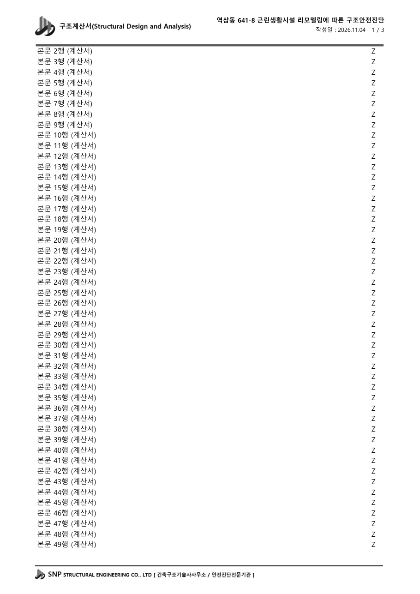

# 구조계산서 첨부용 엑셀 양식 (`구조계산서_양식.xlsm`)

구조계산서에 첨부할 계산식 페이지를 엑셀로 직접 짜기 위한 빈 양식입니다.
A4 세로, 계산식 영역 A~Z(26열 같은 너비)가 100% 배율 그대로 한 장 폭에 들어가고,
모든 장에 머리글, 머리글 아래 굵은 선, 바닥글(선 + 작은 로고 + 회사명)이 찍힙니다.
머리글은 왼쪽에 로고 + 문서명 "구조계산서(Structural Design and Analysis)", 오른쪽에 프로젝트명 /
작성일 · 페이지 번호(`n / N`)입니다(참고본과 같은 배치, 가운데는 비움).



## 1. 쓰는 법

### 프로젝트명·작성일 입력
1. `설정` 시트의 노란 칸에 입력합니다.
   - **C4 — 프로젝트명** (이름 정의 `PROJECT_NAME`, **37자 이하** — 7pt 로 들어가는 최대 글자 수, build 실측값)
   - **C5 — 작성일** (이름 정의 `DOC_DATE`, `2026-11-04` 처럼 날짜로 입력하면 `2026.11.04` 로 표시)
2. 입력하면 모든 계산서 시트의 오른쪽 위 머리글에 바로 들어갑니다.
   - 작성일을 비워 두면 머리글 2행에는 페이지 번호(`n / N`)만 나옵니다.
   - 작성일 칸에 날짜가 아닌 글자를 적으면 적은 그대로 들어갑니다.
   - 프로젝트명의 `&` 는 그대로 `&` 로 찍힙니다. 셀 안 줄바꿈은 공백으로 바뀝니다.
   - 프로젝트명이 길면 머리글 글씨가 **9 → 8 → 7pt** 로 자동으로 작아집니다(작성일·페이지 번호 줄은 8pt 고정).
     이 PC 실측 경계(가중 글자 수, 한글 1 / 영문·숫자·공백 0.55): 9pt ≤ 28.9, 8pt ≤ 32.5, 7pt ≤ 37.6.
     예) 참고본의 "역삼동 641-8 근린생활시설 리모델링에 따른 구조안전진단"(32자, 가중 약 28) → 9pt.
     7pt 로도 넘으면(매크로로 넣는 등 유효성 검사를 거치지 않은 경우) 끝을 잘라 `…` 를 붙입니다.

### 계산식 작성
- `계산서` 시트 **2행부터** 씁니다. 1행은 머리글 아래 굵은 선을 그리는 인쇄 제목 행(높이 4pt)이라 비워 둡니다.
- 열 A~Z 는 모두 같은 너비입니다. 칸을 합치거나 테두리를 넣어 자유롭게 짜면 됩니다.

### 여러 장 쓰기 (시트 복사)
- `계산서` 시트 탭을 **Ctrl 을 누른 채 오른쪽으로 끌거나**, 탭 우클릭 → **[이동/복사] → "복사본 만들기"** 로 복사합니다.
- 복사한 시트에도 머리글·선·바닥글·페이지 설정이 그대로 따라갑니다.
- 새 빈 시트를 `+` 로 추가하면 로고·선·바닥글이 없으니, 반드시 `계산서` 시트를 복사해서 쓰세요.

### 인쇄 / PDF 저장
- **계산서 시트만 골라서** 인쇄합니다. `설정` 시트는 인쇄 대상이 아닙니다.
  (실수로 같이 인쇄돼도 안내문 1장만 나오도록 인쇄 영역을 잡아 두었습니다.)
- 페이지 번호 `n / N`:
  - 계산서 시트 **여러 장을 함께 골라**(Ctrl+탭 클릭) 인쇄하면 번호가 시트를 넘어 **이어서** 매겨집니다.
  - 시트를 하나씩 인쇄하면 시트마다 1부터 시작합니다. (Excel 기본 동작)
- 인쇄 설정은 "가로 1페이지에 맞춤"이 켜져 있습니다. 이 PC 에서는 배율이 줄지 않고 100% 로 찍히며,
  다른 프린터에서 열이 조금 넓게 잡히더라도 Z열이 다음 장으로 넘어가지 않게 받쳐 주는 안전장치입니다.

## 2. 매크로(머리글 자동 반영)

- 이 파일은 `.xlsm` 이고, 머리글 자동 반영은 매크로로 동작합니다. 파일을 열 때 노란 보안 경고줄의
  **[콘텐츠 사용]** 을 눌러 매크로를 허용하세요.
- 매크로가 하는 일 (`HeaderSync.UpdateHeaders`): `설정` 시트를 뺀 모든 시트의 **오른쪽 머리글 글자를 다시 쓰고
  가운데 머리글은 비웁니다**. 왼쪽 머리글의 그림(`&G`, 로고 + 문서명)과 바닥글 이미지는 건드리지 않습니다.
  머리글 글자는 PrintCommunication 을 켠 상태에서 넣습니다(끈 상태로 모아 넣으면 Excel 2013 이 긴 한글 머리글을 거부함, 실측).
- 실행 시점: 파일을 열 때, 인쇄(PDF 저장 포함) 직전, `설정` 시트의 C4/C5 칸이 바뀔 때.
- **매크로를 허용하지 않고 열면** 마지막으로 저장된 상태의 머리글이 그대로 나옵니다.
  (입력칸을 바꿔도 머리글이 따라 바뀌지 않으니, 허용한 뒤 저장하세요.)
- 머리글 전체(왼쪽·가운데·오른쪽, 서식 코드 포함) 글자 수는 Excel 제한(255자)이 있어서, 그보다 길어지는
  프로젝트명은 끝을 잘라 `…` 를 붙입니다. (255자를 넘기면 Excel 이 오류 없이 머리글을 뒤섞어 로고까지 지워집니다.)

## 3. 양식 다시 만들기 (`build_template.py`)

로고를 바꾸거나 양식을 고친 뒤 다시 생성합니다. **Windows + Excel(2013 이상) + pywin32** 가 필요합니다.

```
python -m tools.calc_sheet_template                       # 기본 로고 경로 사용
python -m tools.calc_sheet_template --logo D:\새로고.png  # 다른 로고
python -m tools.calc_sheet_template --out D:\양식.xlsm    # 다른 출력 위치
```

- **로고**: `--logo` 로 받은 원본(.ico/.png)은 읽기만 하고, `assets/logo.png` 로 변환해서 씁니다.
  `.ico` 는 128px 프레임(없으면 가장 큰 프레임)을 고르고 투명도를 유지합니다.
  원본이 없으면 저장소의 `assets/logo.png` 를, 그것도 없으면 `assets/logo_placeholder.png` 를 쓰고 경고를 출력합니다.
- **머리글 이미지**(`assets/header.png` = 로고 10mm + 문서명 맑은 고딕 굵게 9pt)와 **바닥글 이미지**(`assets/footer.png`)는
  로고로부터 매번 다시 합성합니다(Pillow, 300dpi). 로고를 바꾸고 다시 실행하면 두 이미지가 함께 바뀝니다.
- **프로젝트명 글꼴 경계도 PDF 실측**입니다. 오른쪽 머리글에 한글 20자·영문 견본을 9/8/7pt 로 찍어 한 글자 폭을 재고,
  들어갈 폭(머리글 이미지 오른쪽 끝 + 3mm ~ 머리글 오른쪽 끝)으로 단계별 가중 글자 수 경계를 정해
  VBA 상수(`CAP_9PT`/`CAP_8PT`/`CAP_7PT`/`ASCII_WEIGHT`)에 넣고, 입력 상한(유효성 검사)과 설정 시트 안내문도 그 값으로 맞춥니다.
  (이 PC: 한글 9pt 3.175mm / 8pt 2.836mm / 7pt 2.455mm, 영문 평균 폭 0.51 → 가중치 0.55, 들어갈 폭 93.64mm)
- **열 너비와 여백은 PDF 실측으로 자동 결정**합니다. Excel 은 인쇄할 때 기본 프린터 기준으로 열을 화면보다 조금 넓게
  찍기 때문에(이 PC 실측 약 5%), 화면 계산값 대신 100% 배율로 PDF 를 내보내 A~Z 가 180mm 안에 들어가는 가장 큰 너비를
  고르고, 좌우 여백을 `(210mm − A~Z 실측 폭) ÷ 2` 로, 바닥글 이미지 폭을 A~Z 실측 폭으로 맞춥니다.
  → 머리글 선·본문·바닥글 선의 양 끝이 일치합니다. 오른쪽에는 반올림 오차로 배율이 줄지 않도록 0.5mm 여유를 둡니다.
- **머리글·바닥글 그림 크기도 PDF 실측으로 보정**합니다. Excel 은 인쇄할 때 그림을 프린터 기준으로 가로·세로 다른 비율로
  늘려 찍습니다(이 PC 실측: 머리글 가로 1.0514 / 세로 1.1032, 바닥글 가로 1.0513 / 세로 1.1029). build 가 한 번 내보내
  늘어난 비율을 재고, 가로세로 비율 고정을 풀어 그만큼 줄여 지정한 뒤 다시 내보내 확인합니다
  (기준: 로고 비율 1.00±0.02·높이 10±0.3mm, 머리글 이미지 왼쪽 끝과 바닥글 양 끝이 본문과 ±0.5mm).
  측정한 비율과 지정값은 build 로그에 나옵니다.
  PDF 안 로고는 Excel 의 PDF 내보내기에서 약 200dpi 로 다시 샘플링됩니다(원본 128px 보다 늘리지는 않음).
- ⚠ 열 너비·여백·그림 보정은 **build 를 실행한 PC 의 기본 프린터 기준**입니다. 다른 PC·프린터에서 쓸 경우
  그 PC 에서 build 를 다시 실행해야 정확히 맞습니다. (다시 만들지 않고 써도 "가로 1페이지 맞춤"이 Z열 넘침은 막아 줍니다.)
- **VBA 넣기**: `vba/` 의 원본(UTF-8 텍스트)을 Excel COM 으로 통합 문서에 넣습니다
  (`HeaderSync.bas` 가져오기, `ThisWorkbook.vba`·`SettingsSheet.vba` 는 각 코드 모듈에 붙여넣기).
  이를 위해 Excel 의 **"VBA 프로젝트 개체 모델에 안전하게 액세스"** 가 켜져 있어야 합니다.
  - 스크립트는 이 설정(레지스트리 `AccessVBOM`)을 **읽기만** 하고 바꾸지 않습니다. 시작 전·종료 후 값을 출력합니다.
  - 꺼져 있으면 안내를 출력하고 멈춥니다. 직접 켜고(파일 > 옵션 > 보안 센터 > 보안 센터 설정 > 매크로 설정) 실행한 뒤
    다시 끄거나, 아래 "매크로 직접 가져오기"로 넣으세요.
- Excel 이 **정품 인증 마법사** 같은 대화상자를 띄우면 자동화 호출이 모두 거부되어 생성이 멈춥니다.
  오류 메시지에 떠 있는 창 제목을 보여 주니, Office 인증을 먼저 해결하세요.

### 매크로 직접 가져오기 (신뢰 설정을 켤 수 없을 때)
1. 양식을 연 뒤 Alt+F11 (VBA 편집기).
2. [파일] → [파일 가져오기] → `vba/HeaderSync.bas` (UTF-8 이므로, 한글이 깨지면 메모장에서 "ANSI" 로 다시 저장한 뒤 가져오기).
3. 왼쪽 트리의 `ThisWorkbook` 을 더블클릭하고 `vba/ThisWorkbook.vba` 내용을 붙여넣기.
4. `설정` 시트 모듈을 더블클릭하고 `vba/SettingsSheet.vba` 내용을 붙여넣기.
5. `.xlsm` 으로 저장.

## 4. 검증 (`verify_template.py`)

생성한 양식의 사본으로 PDF 를 내보내 실측합니다(원본은 건드리지 않음).

```
python -m tools.calc_sheet_template.verify_template --out-dir output\calc_sheet_template\verify
```

배율(맞춤 vs 100%), 열 폭, 머리글 선·본문·바닥글 선의 양 끝 정렬, 시트 복사 후 여러 장 출력의 머리글·선·바닥글·페이지 번호,
`&` 가 든 프로젝트명 / 빈 작성일 / 긴 프로젝트명, 인쇄 직전(BeforePrint) 반영, 로고 크기·비율·해상도를
`report.json` 과 페이지 PNG 로 남깁니다.

## 5. 파일 구성

| 경로 | 내용 |
|---|---|
| `build_template.py` | 양식 생성 스크립트 |
| `verify_template.py` | PDF 실측 검증 스크립트 |
| `vba/HeaderSync.bas` | 머리글 반영 모듈 (UpdateHeaders) |
| `vba/ThisWorkbook.vba` | Workbook_Open / Workbook_BeforePrint |
| `vba/SettingsSheet.vba` | 설정 시트 Worksheet_Change |
| `assets/logo.png` | 원본 로고에서 만든 128px PNG (커밋해 둠) |
| `assets/logo_placeholder.png` | 로고가 없을 때 쓰는 자리표시 |
| `assets/header.png` | 머리글 합성 이미지: 로고 + 문서명 (생성물) |
| `assets/footer.png` | 바닥글 합성 이미지: 선 + 작은 로고 + 회사명 (생성물) |
| `docs/검증_*.png` | PDF 검증 캡처 (시트 복사 4/5장, 참고본 프로젝트명 9pt, 200자 7pt 말줄임) |
| `구조계산서_양식.xlsm` | 생성된 양식 |
